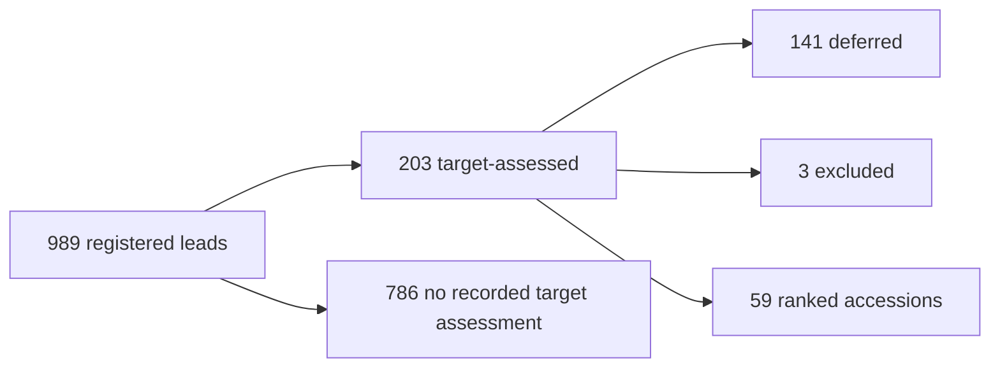

# Find enzymes that ligate glutarate and cadaverine

Open [the self-contained dashboard](index.html) for the searchable candidate table and figures.

## Timing, tokens and coverage

| Metric | Value | Definition |
|---|---|---|
| Discovery wall time | 1 h 46 min 38 s | Manifest start → finish; later modeling excluded |
| Started | 2026-11-06T00:08:53.353078-06:00 | Timestamp includes UTC offset |
| Finished | 2026-11-06T01:55:31.075536-06:00 | Timestamp includes UTC offset |
| Run status | budget_exhausted | Resumable; token budget reached |
| Model | claude-code:claude-sonnet-5-5 | As recorded by the run |
| Total tokens | 3,009,366 | Prompt + completion, including cached prompt reads |
| Prompt tokens | 2,589,931 | New input + cache creation + cache reads |
| Completion tokens | 419,435 | Recorded model output |
| New input tokens | 166 | Uncached input category; cache creation reported separately |
| Cache creation tokens | 1,848,125 | Included in prompt tokens |
| Cache read tokens | 741,640 | 28.64% of prompt tokens |
| Model calls | 83 | Unmetered calls: 0; accounting complete: True |
| Controller iterations used | 75 | Manifest counter; distinct from model-call count |
| Token budget / overrun | 3,000,000 / 9,366 | Final call crossed the budget |
| Registered lead records | 989 | Registry records; not deduplicated proteins or validated hits |
| Evaluation operations | 183 | Manifest result counter; not final status count |
| Latest status: evaluated | 168 | Final registry snapshot |
| Pending checkpoint entries | 799 | Checkpoint scope; not derived from registry status subtraction |
| Ranked candidates | 59 | Unique accessions in ranked_candidates.csv |
| Ranked InterPro families | 11 | Recorded family labels; no taxonomy normalization |
| Registry family IDs | 30 | Primary annotated ID, otherwise screening ID; one per record |
| Landscape fold IDs | 16 | Initial exploration landscape; separate scope |
| Mechanism hypotheses | 6 | Reasoned hypotheses; not experimental coverage |
| Ranked mechanism labels | 4 | Recorded broad assignments; 1 candidates unassigned |
| Target-assessed registry records | 203 | Final records with a target_assessment; one per accession |
| Leads without target assessment | 786 | No recorded target review; not an experimental negative |
| Recorded tool calls / tool types | 58 / 17 | Explicit tool_call events; internal helper activity excluded |
| Paper records encountered | 242 | Checkpoint count; not a count of fully read or unique publications |
| Full-text acquired / attempted identifiers | 2 / 9 | Download ledger; unavailable papers are not negative evidence |
| Numeric partner-pair comparisons | 43 / 59 | Both required partners have recorded analogue_fit values |
| Registry leads without a family ID | 31 | Included explicitly in the family review coverage figure |

## Search story

The relationships below are verified against the final registry and exported accessions. Counts are records, except for the unique exported accessions.



## Figures

- [Search overview: growth, routes, reviews, families, partner fit and evidence gaps](overview.png) ([SVG](overview.svg))
- [Detailed search timeline](search_timeline.png) ([SVG](search_timeline.svg))
- [Review outcomes for every family, including unassigned leads](family_review_coverage.png) ([SVG](family_review_coverage.svg))
- [Accounting overview](accounting_overview.png) ([SVG](accounting_overview.svg))
- [Full family counts](family_coverage.png) ([SVG](family_coverage.svg))
- [Token accounting](token_accounting.png) ([SVG](token_accounting.svg))
- [First 15 candidates](candidate_table.png) ([SVG](candidate_table.svg))

## All ranked candidates

Original export order; hypotheses rather than demonstrated target activity.

| Rank | Enzyme / protein | Accession | Family ID | Tier |
|---|---|---|---|---|
| 1 | Putrebactin synthase | P0DXD6 | IPR037455 | prioritized hypothesis |
| 2 | Putrebactin synthase | Q0HWI9 | IPR037455 | prioritized hypothesis |
| 3 | Gamma-glutamylputrescine synthetase PuuA | A0A1C9WBW9 | IPR008146 | candidate to investigate |
| 4 | Gamma-glutamylpolyamine synthetase GlnA2 | Q9RDS6 | IPR004809 | candidate to investigate |
| 5 | Gamma-glutamylputrescine synthetase PuuA | P78061 | IPR008146 | candidate to investigate |
| 6 | Desferrioxamine E synthetase DesD | A0ABN1NGB5 | IPR037455 | candidate to investigate |
| 7 | Putative acid--amine ligase YgiC | P0ADT5 | IPR005494 | candidate to investigate |
| 8 | Acyl-CoA synthetase | Q5CD72 | IPR051087 | candidate to investigate |
| 9 | Desferrioxamine E synthetase DesD | A0ABN1RQI0 | IPR037455 | candidate to investigate |
| 10 | Putative acid--amine ligase YjfC | P33222 | IPR005494 | candidate to investigate |
| 11 | Desferrioxamine E synthetase DesD | A0ABN1TCT3 | IPR037455 | candidate to investigate |
| 12 | Desferrioxamine E synthetase DesD | A0ABN3J2R9 | IPR037455 | candidate to investigate |
| 13 | Desferrioxamine E synthetase DesD | A0ABP3H6S0 | IPR037455 | candidate to investigate |
| 14 | Desferrioxamine E synthetase DesD | A0ABP3RUX6 | IPR037455 | candidate to investigate |
| 15 | Desferrioxamine E synthetase DesD | A0ABP5A0Y5 | IPR037455 | candidate to investigate |
| 16 | Desferrioxamine E synthetase DesD | A0ABP5N6T1 | IPR037455 | candidate to investigate |
| 17 | Desferrioxamine E synthetase DesD | A0ABP5T9V5 | IPR037455 | candidate to investigate |
| 18 | Desferrioxamine E synthetase DesD | A0ABP7IT19 | IPR037455 | candidate to investigate |
| 19 | NRPS-independent siderophore synthetase rfs | I1C129 | IPR037455 | candidate to investigate |
| 20 | Uncharacterized protein | Q9L069 | IPR037455 | candidate to investigate |
| 21 | Gamma-glutamylpolyamine synthetase GlnA3 | Q9KZC7 | IPR008146 | candidate to investigate |
| 22 | Putative glutamate--cysteine ligase 2 | A0A1H4U7K7 | IPR002933 | candidate to investigate |
| 23 | Putative glutamate--cysteine ligase 2 | A0A2S2BQ12 | IPR002933 | candidate to investigate |
| 24 | Putative glutamate--cysteine ligase 2 | A0A402C1H7 | IPR002933 | candidate to investigate |
| 25 | Putative glutamate--cysteine ligase 2 | A0A974ZV78 | IPR002933 | candidate to investigate |
| 26 | Putative glutamate--cysteine ligase 2 | A0A9X4LYF5 | IPR002933 | candidate to investigate |
| 27 | Putative glutamate--cysteine ligase 2 | A0AAX3YF65 | IPR002933 | candidate to investigate |
| 28 | Putative glutamate--cysteine ligase 2 | A0ABP8NYC7 | IPR002933 | candidate to investigate |
| 29 | Putative glutamate--cysteine ligase 2 | A0ABT1QIZ7 | IPR002933 | candidate to investigate |
| 30 | Putative glutamate--cysteine ligase 2 | A0ABU4CP25 | IPR002933 | candidate to investigate |
| 31 | Putative glutamate--cysteine ligase 2 | A0ABU7L824 | IPR002933 | candidate to investigate |
| 32 | Putative glutamate--cysteine ligase 2-3 | Q0S8V5 | IPR002933 | candidate to investigate |
| 33 | Putative glutamate--cysteine ligase 2 | X0PN35 | IPR002933 | candidate to investigate |
| 34 | Spermidine-citrate ligase | A0A0F7RJ52 | IPR037455 | candidate to investigate |
| 35 | D-ornithine--citrate ligase | Q2FW70 | IPR037455 | candidate to investigate |
| 36 | L-2,3-diaminopropanoate--citrate ligase | Q2G1M9 | IPR037455 | candidate to investigate |
| 37 | Asparagine synthetase [glutamine-hydrolyzing] | A0A0S2IKQ5 | IPR006426 | candidate to investigate |
| 38 | Asparagine synthetase [glutamine-hydrolyzing] | A0A1D5SUB6 | IPR006426 | candidate to investigate |
| 39 | asparagine synthase (glutamine-hydrolyzing) | A0A1I2XEU9 | IPR006426 | candidate to investigate |
| 40 | Asparagine synthetase [glutamine-hydrolyzing] | A0A2K1IVM2 | IPR006426 | candidate to investigate |
| 41 | asparagine synthase (glutamine-hydrolyzing) | A0A4U0MRF2 | IPR006426 | candidate to investigate |
| 42 | asparagine synthase (glutamine-hydrolyzing) | A0A4Z0G8S2 | IPR006426 | candidate to investigate |
| 43 | Asparagine synthetase, nodule [glutamine-hydrolyzing] | P19251 | IPR006426 | candidate to investigate |
| 44 | Asparagine synthetase [glutamine-hydrolyzing] 1 | P54420 | IPR006426 | candidate to investigate |
| 45 | Putative asparagine synthetase [glutamine-hydrolyzing] | P9WN33 | IPR006426 | candidate to investigate |
| 46 | 2-[(L-alanin-3-ylcarbamoyl)methyl]-3-(2-aminoethylcarbamoyl)-2-hydroxypropanoate synthase | Q2G1M8 | IPR037455 | candidate to investigate |
| 47 | Trypanothione synthetase | O60993 | IPR051705 | candidate to investigate |
| 48 | Glutathionylspermidine synthase | P90518 | IPR051705 | candidate to investigate |
| 49 | Staphyloferrin A synthase | Q2FW72 | IPR037455 | candidate to investigate |
| 50 | 8-demethylnovobiocic acid synthase | Q9L9F6 | IPR000873 | candidate to investigate |
| 51 | Alanine--anticapsin ligase | P39641 | IPR011761 | deprioritized analogue |
| 52 | N(2)-citryl-N(6)-acetyl-N(6)-hydroxylysine synthase | Q47316 | IPR037455 | deprioritized analogue |
| 53 | N(2)-citryl-N(6)-acetyl-N(6)-hydroxylysine synthase | Q76BS7 | IPR037455 | deprioritized analogue |
| 54 | Asparagine synthetase [glutamine-hydrolyzing] | A0A5J9TLB9 | IPR006426 | deprioritized analogue |
| 55 | Bifunctional glutathionylspermidine synthetase/amidase | P0AES1 | IPR051705 | deprioritized analogue |
| 56 | Citryl-spermidine/3,4-dihydroxybenzoyl-citryl-spermidine:spermidine ligase | Q81RQ8 | IPR037455 | deprioritized analogue |
| 57 | Glutamine synthetase | P9WN36 | IPR008146 | deprioritized analogue |
| 58 | Formate-dependent phosphoribosylglycinamide formyltransferase | Q0W4L8 | IPR005862 | deprioritized analogue |
| 59 | Staphyloferrin B synthase | Q2G1N1 | IPR037455 | deprioritized analogue |

## Definitions and limits

- Accounting covers the original discovery phase only. Later structural modeling, GPU time, and visualization generation are excluded; their cost cannot be inferred from this token ledger.
- Token totals count prompt plus completion tokens, including repeated cache reads. They are not unique text tokens or monetary cost. Cache reads must not be added to the prompt total a second time.
- A registry record is a lead, not necessarily a unique sequence. The manifest evaluation counter, latest registry statuses, and pending-checkpoint list have different scopes and do not form a single funnel.
- Family coverage uses recorded InterPro IDs and family labels, which can describe domains, families, or superfamilies. The registry ID count does not establish an equal number of independent mechanisms or experimental coverage.
- Recorded target-activity evidence counts: {'mechanistic_transfer': 59}. Native characterization and target activity are distinct. Recorded broad mechanism assignments are reproduced without reclassification and may be coarse.
- Deprioritized analogue entries are retained in the full table. Exported tier and target-assessment decision are separate fields; the original values are preserved in candidates.csv.
- The new overview uses final-registry target assessments, not the manifest evaluation counter. Exported accessions were verified to equal the prioritize/investigate subset of those assessments. Earlier review revisions are not counted again.
- Lead-growth timing uses registry first_seen timestamps; target-review timing uses the first journal assessment for each final assessed accession. Final source tags describe the recorded source and are not a reconstruction of every discovery route.
- Partner resemblance is the run's recorded analogue_fit, not measured binding or activity. Identical points are grouped by exported tier and marker area encodes their count. Missing numeric comparisons are omitted from the scatter and reported explicitly; no values are imputed.
- The evidence-gap panel uses three different denominators: all registered records, all ranked accessions, and identifiers in the full-text download ledger. Those bars are not sequential stage-conversion rates.

## Reproduce

Run from the repository root using Python with matplotlib and NumPy installed:

```bash
OMP_NUM_THREADS=1 OMP_THREAD_LIMIT=1 OPENBLAS_NUM_THREADS=1 MKL_NUM_THREADS=1 NUMEXPR_NUM_THREADS=1 python analysis/discovery_run_visualizations.py '/nfs/lambda_stor_01/homes/rzhu/Enzyme_agent/enzyme_discovery_agent/runs/20261106_000850_Find_enzymes_that_ligate_glutarate_and_cadaverine_Production_objective_deliver_a' --out '/nfs/lambda_stor_01/homes/rzhu/Enzyme_agent/analysis/reports/discovery_20261106'
```

All data and biological labels are read from the supplied run; the generator imports no discovery code. `provenance.json` records source hashes. `summary.json` records accounting checks. Plots are descriptive counts and provider accounting; no inferential error bars or significance tests apply.
