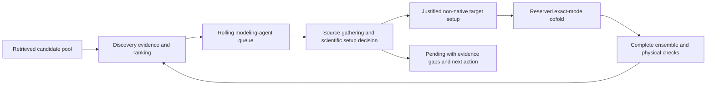

# Automatic ranked-candidate structural investigation

Production discovery now hands each new published rank to the independent
structural-modeling agent. The standard discovery CLI attaches its coordinator
before discovery starts; `--discovery-only` explicitly disables that handoff.
Programmatic production launchers call `rolling_modeling.attach(run_dir)`.
The current run was attached without restarting discovery.

The coordination boundary is deliberately different from GPU admission:

Every published rank reaches investigation. Neither an absent native reaction
nor a plausible fold by itself authorizes expensive predictions. The modeling
agent weighs primary studies, reaction annotations, sequence/domain evidence
and structures, distinguishing exact-protein results from inferred annotations
and homolog transfers. The decision must explain the useful uncertainty a cofold
can resolve, the cheaper evidence already considered, the justified molecular
setup, contradictory observations and remaining assumptions. Source and
consistency checks do not independently establish that its interpretation is true.

The requested target contract travels with each candidate. Non-native substrates
are the intended test, and native-only controls cannot substitute for them.
A partial-step model must state which target partner it omits and what remains
untested. The agent chooses controls when they discriminate model/setup failure
from a target-specific difference; it should not enumerate arbitrary state,
cofactor or ligand combinations.

MSAs are batched and cached by exact sequence. Predictions require Boltz-2 exact
mode and 50 samples per justified setup. Complete molecular entities, copy
counts, charge and reaction restraints matter for reuse: the same protein with
another substrate is not the same modeled system. Complete cached systems still
need provenance, numerical-profile and sampling review. The backend now checks
the actual molecular system rather than blocking every new target merely because
a protein has some earlier prediction.

The current coordinator runs one modeling task and one reserved GPU ensemble
at a time. Research has a 100,000-token allowance and 20-call limit per task, including
an eight-turn setup limit; new scientific evidence can reopen a task within the
attempt bound. There is no fixed eight-candidate portfolio cap in ranked mode.
A total modeling-token limit may also be supplied. The current attachment uses
per-candidate limits rather than sharing or silently extending discovery's token
allowance. It has a 12-hour coordinator window and resumable pending records.
The token allowance is checked between model calls; an in-flight response can
exceed the remaining allowance. These limits can leave tasks unresolved; they do not justify reporting all
candidates as modeled.

The discovery process, coordinator and modeling worker have separate CPU
allocations. Native thread pools are capped. The GPU provider verifies imports,
weights, storage and free accelerators, acquires the shared reservation gate and
checks for foreign resident processes. Existing live coordinators are reused;
dead owners require reconciliation rather than blind duplicate submissions.

Reports preserve failed poses, unresolved setups and incomplete ensembles.
The frozen inverse-distance-weighted attack angle is used only when applicable,
with harmonic distance alongside it. A favorable pose, confidence score or
activation-only model does not demonstrate acceptance of both target partners
or experimental activity. Timing and scientific-quality gains remain to be
established in the live campaign.

## Evidence lesson from the current development task

Gamma-glutamylpolyamine synthetase GlnA2 (Q9RDS6) illustrates why binary substrate
annotations are insufficient. Its primary study reports cadaverine turnover but
describes cadaverine as a poor substrate. Glutarate acceptance remains untested;
calling this the best complete-pair catalyst is unsupported.
[Primary study](https://pmc.ncbi.nlm.nih.gov/articles/PMC8998196/).
This observation was not supplied as an enzyme seed to the fresh campaign.

## Verification

Regression coverage checks growth of the published ranked list, exclusion of
unranked records, handoff without a native-annotation gate, repeated-coordinator
attachment, dead-owner reconciliation, batched sequence preparation and
molecular-system reuse checks across different ligands, assemblies and charges.
Full release results and the live attachment record are recorded separately.
