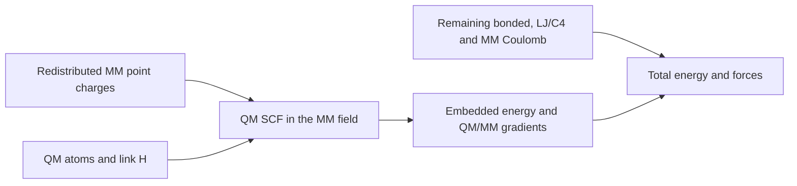

# Electrostatic embedding setup for review

Review date: 2026-11-11. Scope: the actual AS9 and GlnA3 activation snapshots
currently used for embedded DFT diagnostics. The atom lists, point charges and
constructed MM Hamiltonians pass the structural checks below, and all eight
selected real-enzyme DFT/MM force derivatives pass. **This verifies the numerical
implementation, not quantitative barriers.** Radius, boundary and basis
sensitivity remain necessary.

## 🔬 Actual molecular partitions

| Activation system | Real QM atoms | Link H | QM charge | QM electrons including links | Mg | Nonzero embedding charges |
|---|---:|---:|---:|---:|---:|---:|
| AS9 + adipate + ATP | 127 | 5 | -3 | 550 | 1 | 10,177 |
| GlnA3 + glutarate + ATP | 171 | 8 | -5 | 762 | 2 | 10,823 |
| GlnA3 + L-glutamate + ATP | 174 | 8 | -4 | 770 | 2 | 11,082 |

All are closed-shell singlet calculations. Whole ATP, acid substrates, Mg and
the selected waters are quantum mechanical. Every N/O/S donor within 2.7 Å of
each Mg in the snapshot is included. Protein sidechains use CA–CB boundaries;
AS9's catalytic Lys is included. The GlnA3 target/native pair uses the same
eight protein residue indices: 150, 152, 206, 213, 262, 333, 354 and 512
(zero-based Amber topology indices). The full selections are exported rather
than inferred from these counts.

The preparation scripts use ff14SB protein, GAFF2 ligands, TIP3P water and
Li–Merz 12-6-4 ion parameters. ATP library/frcmod hashes are identical across
all three setups; their paths/hashes are exported in
`ee_forcefield_preparation_provenance.json`. GlnA3's local assembly is a
structural hypothesis made by fitting exact-sequence subunits to the 4HPP
template assembly. These numerical partition checks do not establish the
biological assembly or the bound-state protonation experimentally.

Substrate charges are adipate -2, glutarate -2, L-glutamate -1, ATP -4 and Mg +2.
Therefore the GlnA3 pair is not an equal-charge perturbation. Proton inventories
and charges are explicit and fixed along each individual path.

These are step-1 activation models. Aminolysis is a separate setup with activated
acid plus HMDA2+ for AS9, or cadaverine2+ and ADP3- for GlnA3. Its acceptors,
water relays and QM partitions still require review after the classical pilots.
Do not interpret the activation selections above as approved aminolysis regions.

## ⚙️ Electronic coupling and energy expression

The MM charges enter the QM one-electron Hamiltonian before SCF convergence.
They polarize the QM electron density; they are not an energy correction added
after a vacuum calculation. This uses PySCF/GPU4PySCF's `mm_charge` interface.[^1]
A new test explicitly confirms that the density matrix changes when the MM
field is applied. Whole-system translation invariance and total-force balance
are also tested.



```text
E_total = E_DFT(QM + link H; redistributed MM point charges)
        + E_MM(remaining bonded terms + retained LJ/C4 + MM/MM Coulomb)

F_total = projected QM/link forces + forces on embedding charges
        + remaining classical forces
```

The current DFT pilot uses restricted wB97M-V/def2-SVP, density fitting, grid
level 3, SCF energy convergence 1e-9 Hartree, and at most 150 SCF cycles.
Finite-difference validation tightens convergence to 1e-10 Hartree. SVP is a
diagnostic basis; the existing larger-basis target is not yet validated.
An unconverged SCF cannot contribute an accepted result.

The current implementation explicitly defaults to `grid_response=True`,
including moving-grid response terms. This has passed CPU tests through a
covalent QM/MM link and a GPU wB97M-V test (largest selected derivative error
7.31e-6 eV/Å). The original frozen geometry pilots and v1 derivative controls
use the installed PySCF default `grid_response=False`; they are preserved for
comparison. The corrected numerical profile additionally uses CUDA double
precision for MM and a smooth LJ/C4 switch from 10 to 12 Å. Its real-enzyme
v3 checks pass for AS9 and GlnA3 target. Grid convergence remains necessary
before DFT saddle certification.

Coordinates sent to the embedding interface are in Å; charges are in elementary
charge. Quantum energies/gradients are converted from Hartree and Hartree/Bohr
to eV and eV/Å. The OpenMM remainder converts kJ/mol and kJ/mol/nm to the same
units. The same redistributed charges are used in the electronic embedding
and the classical remainder.

MM atoms use fixed force-field charges. QM polarization is self-consistent;
mutual MM polarization is not present. The 12-6-4 terms approximate the retained
metal/MM interactions, rather than replacing electrostatic embedding.

## 🧩 Boundary and classical-term bookkeeping

| Item | Implemented policy |
|---|---|
| QM partial charges in the MM nonbonded force | Set to zero |
| MM exceptions involving a QM atom | Classical Coulomb set to zero |
| QM–QM LJ/C4 | Excluded |
| Fully QM classical bonds, angles and proper torsions | Removed |
| QM–MM LJ/C4 and bonded terms crossing a boundary | Retained |
| Unsupported force classes, CMAP inside QM, ambiguous cuts | Fail for explicit review |
| Boundary CA charge | Zeroed |
| Residual charge from the cut residue | Redistributed over its remaining MM backbone sites |
| Whole-residue library rounding | Logged; total residual must be below 0.005 e |
| Link position | Fixed initial CA–CB interpolation ratio, initially placing H 1.09 Å from CB |
| Link forces | Full coordinate Jacobian projected to both CB and CA |

The fixed-ratio link stretches slightly if CA–CB changes. It is not a
constant-length link. Boundary/link and charge-redistribution sensitivity
therefore remain scientific checks, even when numerical derivatives pass.
The nearest charged MM atom to a QM/link site is 1.292 Å for AS9 and 1.278 Å
for each GlnA3 model, in each case a backbone HA near a cap. There is no point
charge on a cap or its CA parent. These close charges should be included in
boundary and diffuse-basis sensitivity investigations.

## 🌐 Spatial and periodic conventions

| Setting | Current DFT/MM diagnostic | Native reference paths |
|---|---|---|
| Electrostatic embedding | Fixed MM point charges inside QM SCF | Native AM1/D electrostatic QM/MM |
| Quantum environment | Finite, nonperiodic | Periodic, with native QM Ewald/PME |
| Charge selection | Fixed union of whole MM residues within 20 Å of any real QM atom at snapshot creation | Native `qmcut=12 Å`, `qm_ewald=1`, `qm_pme=1` |
| MM Coulomb | Nonperiodic reaction field, 12 Å cutoff, dielectric 78.5 | Native periodic PME, 10 Å real-space cutoff |
| MM LJ/C4 cutoff | Smooth switch from 10 to 12 Å | Native reference profile; not matched to the DFT switch |
| MM numerical precision | CUDA double for GPU DFT; CPU profile retained as an explicit diagnostic | Native double-precision energies/forces |
| Mobile atoms | Whole residues within 8 Å of the QM region, fixed membership | Same specified mobile atom list during path/endpoint searches |
| Charge adjustment | Explicit exported redistribution | Native `adjust_q=2` |

The 20 Å selection is a whole-residue shell around the QM region, not a sphere
centered on one reaction atom. Membership is fixed along an individual path;
whole-molecule reimaging preserves the periodic snapshot's local environment.
Full-precision coordinates and their actual NPT cell are hashed. PDB `CONECT`
does not define chemistry, and old stale PDB cell headers are not reused.

The full prepared cells are neutral within library rounding, but the finite
electronic embedding models do not retain every counterion or charged residue:

| System | Retained MM point-charge sum (e) | QM plus retained charges (e) |
|---|---:|---:|
| AS9 | -8 | -11 |
| GlnA3 glutarate | -2 | -7 |
| GlnA3 glutamate | -1 | -5 |

These are exported actual sums, not a charge-conservation failure. Omitted
outer MM atoms supply the rest of each full cell's charge. This makes
long-range/radius convergence a material requirement, especially for
cross-enzyme comparisons. Charges are not arbitrarily rescaled to make a
truncated shell neutral.

**The two Hamiltonians are not currently matched.** Do not subtract native
periodic totals from finite DFT/MM totals to claim a DFT correction or a free
energy. A production comparison needs consistent long-range electrostatics,
boundary treatment and classical decomposition, followed by numerical checks.
The existing finite DFT model is useful for diagnostics; its environmental
convergence has not yet been demonstrated.

## ✅ Evidence available for inspection

The current 18 structural invariants pass for all three snapshots. They check
the actual constructed OpenMM system, not filenames or declared booleans:

- Unique, disjoint QM/embedding indices and complete link coverage of covalent cuts.
- Integer QM charge, electron parity and zero classical QM charges.
- Agreement between exported embedding charges and remaining-MM charges.
- Conserved total charge within the recorded library-rounding tolerance.
- Zero QM classical Coulomb exceptions and zero fully-QM bonded terms.
- Removal of QM–QM LJ/C4, with a C4 force present for Mg systems.
- Inclusion of every Mg and its observed first-shell N/O/S donors.
- Absence of a point charge at a QM atom or link site.
- Enabled smooth switching for both LJ and C4 forces.

Charge-rounding residuals are +0.001001 e (AS9), +0.003001 e (GlnA3 target),
and +0.002002 e (GlnA3 native). These are small input-library rounding residuals,
not attempts to assign the two GlnA3 substrates the same charge.

Small-system CPU and GPU tests verify embedded QM and MM force derivatives.
An analytic test verifies the link Jacobian, and an actual SCF boundary test
verifies QM, MM link-parent and MM point-charge derivatives with grid response
both disabled and enabled. Native AM1/D real-enzyme
derivatives have passed for AS9, GlnA3 target and GlnA3 native. DFT derivatives
on the actual enzyme snapshots test four components: nucleophile, Mg, MM link
parent and a nearby MM embedding charge. All eight pass the unchanged
0.002 eV/Å threshold at displacement ±0.0001 Å:

| Component | AS9 error (eV/Å) | GlnA3 glutarate error (eV/Å) |
|---|---:|---:|
| QM nucleophile | 5.552e-5 | 5.840e-5 |
| QM Mg | 5.540e-5 | 2.220e-4 |
| MM link parent | 2.214e-6 | 3.455e-6 |
| MM embedding charge | 5.976e-7 | 2.414e-6 |

Mg first-shell coverage was also checked in the relaxed reactants/products
and all constrained seed images: all 61 geometries retain every observed
first-shell N/O/S donor inside the fixed QM region. These are coverage checks,
not proof that the imposed paths contain transition states.

The corrected MM-only Hamiltonians pass 24 derivative checks: four atoms at
both ±0.0001 and ±0.001 Å for AS9, GlnA3 target and GlnA3 native. Their maximum
errors are 8.17e-6, 1.55e-6 and 1.64e-6 eV/Å respectively. Independent CPU PySCF
and GPU4PySCF embedded wB97M-V/def2-SVP water calculations agree within
1.98e-7 eV in energy, 1.59e-6 eV/Å for QM forces and 3.41e-8 eV/Å for MM forces.
The source test suite passes 36 tests; three additional RDKit chemistry tests
pass in their separate environment. XML/log evidence is saved in the run root.

The earlier AS9 control **without grid response** has a passing nucleophile
derivative (error 0.001078 eV/Å) and failing Mg (0.002251 eV/Å) and MM-charge
(0.002691 eV/Å) derivatives. Full grid response corrects the QM contribution,
but the MM-charge error persists with CPU MM arithmetic. Separating the terms
at the identical geometry isolates its quantum derivative error to 5.3e-7
eV/Å, and its CPU MM error to 0.002690 eV/Å. A CUDA-double MM-only test gives
3.1e-8 eV/Å for that MM atom, at the same displacement.

A larger-step Mg control also exposed an energy jump at the original hard
LJ/C4 cutoff. Both terms now switch smoothly from 10 to 12 Å; a dedicated test
checks vanishing energy/force at the cutoff. This intentionally changes the
finite MM numerical/model profile. Earlier outputs are retained as controls;
the combined v3 profile has now passed the direct tests above. The real-
enzyme force threshold remains 0.002 eV/Å; it has not been loosened.

Before adding the switch, the extracted MM audit builder was compared against
the original frozen DFT producer; serialized-system hashes agreed for all
three systems. That historical equivalence evidence is
`ee_audit_running_DFT_Hamiltonian_equivalence.json`. Current v3 audits explicitly
include the new switch and must not be treated as the old Hamiltonian.

The first AS9 DFT evaluation converged but leaves a 5.91 eV/Å residual QM force
at a reference-optimized geometry. Therefore that geometry is not a DFT
stationary point. No static reference saddle or constrained maximum is being
presented as a validated DFT barrier.

## 📂 Review files and reproduction

Run root: `runs/barrier_maturation_20261110/`.

| System | Snapshot | Audit/export directory |
|---|---|---|
| AS9 | `as9_cell_verified_snapshot` | `as9_cell_verified_snapshot_ee_audit_v3` |
| GlnA3 target | `glna3_glutarate_2mg_shared_qm_snapshot` | `glna3_glutarate_2mg_shared_qm_snapshot_ee_audit_v3` |
| GlnA3 native | `glna3_glutamate_2mg_shared_qm_snapshot` | `glna3_glutamate_2mg_shared_qm_snapshot_ee_audit_v3` |

Each audit directory contains `audit.json`, `qm_atoms.csv`,
`embedding_charges.csv` and `links.json`. The CSVs expose atom/residue indices,
coordinates and actual charge values. Both zero-based and one-based QM atom
indices are supplied. `region.json` in each snapshot gives the full selection,
formal-charge entries and MM-charge updates; `input.json` hashes every input.
CSV coordinates are the snapshot seeds; each evaluation's actual coordinates
are identified in its configuration. Membership and charge values remain fixed
while the selected coordinates move during optimization.
`EE_VALIDATION_STATUS.json` gives the current numerical-check status.
`remaining_mm_smooth_double_checks_v3.json`,
`ee_CPU_GPU_quantum_equivalence.json`, `ee_unit_tests_v3.xml` and
`ee_chemistry_tests_v3.xml` contain the corresponding checks. Runtime package
versions and the CUDA plugin binary hash are in `ee_runtime_profile_v3.json`.

Reproduce an audit without reserving a GPU:

```bash
python -m enzyme_barrier.embedding_audit --snapshot SNAPSHOT --out NEW_AUDIT_DIR
python -m pytest enzyme_barrier/tests -q
```

Current real-enzyme force-check configurations are
`as9_ee_smooth_double_validation_v3_config.json` and
`glna3_glutarate_2mg_ee_smooth_double_validation_v3_config.json` in the run root.
The v1/v2 files remain controls for earlier grid-response/CPU-MM profiles.
They are launched through reserved workers; running those configs requires
the quantum environment and a GPU reservation.

The current quantum environment can load its compatible CUDA OpenMM plugin
from the managed MD environment by setting this before importing OpenMM:

```bash
export OPENMM_PLUGIN_DIR=/nfs/lambda_stor_01/homes/rzhu/Tool/envs/processivity-md-20261106/lib/python3.12/site-packages/OpenMM.libs/lib/plugins
```

The launch manifests record that environment setting and explicit CUDA double
precision. The CUDA MM finite-difference probe verified the loaded runtime.
An unavailable requested platform raises an error; there is no silent CPU
fallback for the GPU target profile.

## 📋 Remaining checks before quantitative comparison

The user review can assess these concrete choices now: the finite versus
periodic target, charge redistribution, fixed-ratio caps and the QM selections.
The numerical implementation checks above are complete for this tested profile.
Changed chemistry, partitions or numerical profiles require revalidation.
Scientific convergence needs larger QM/embedding selections,
boundary and basis checks, SCF solution stability, a matched reference/target
Hamiltonian and an ensemble correction with adequate overlap. Transition-state
connectivity and free-energy sampling validation follow; none is established
merely by passing an embedding audit.

Historical vacuum outputs retain their relative-only reporting restriction.
Error cancellation within a substrate pair is a hypothesis to test, and
cross-enzyme absolute vacuum-barrier comparisons remain unsupported.

[^1]: PySCF, QM/MM methods. MM charges are included in the electronic Hamiltonian and support RKS embedding. https://pyscf.org/user/qmmm.html
