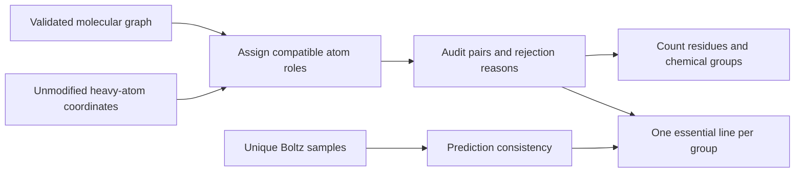

# Heavy-atom protein–ligand contact protocol

_Version `heavy_atom_donor_acceptor_v2`; AS9 M3/M4 application, 2026-11-10._

This protocol marks **chemically compatible heavy-atom contacts**, not proven hydrogen bonds, experimentally real interactions, binding energies, or catalytic necessity. Boltz coordinates do not resolve hydrogen positions or protein protonation microstates. The ligand input does specify a molecular graph and formal charge, which must be preserved. No hydrogens or protonation states are generated by this analysis.

## Scope and chemical decisions

The reusable implementation is [contact_analysis.py](contact_analysis.py). Its current profile covers protein **sidechain donors/cationic groups contacting explicitly supplied ligand acceptor/anionic groups**. It does not cover backbone contacts, hydrophobic packing, aromatic interactions, metal coordination, water bridges, or the reverse ligand-donor/protein-acceptor direction. Those require separate, named profiles; their absence from these plots is not evidence that they are absent or unimportant.

| Classification | Chemical prerequisite | Heavy-atom criterion | Interpretation |
|---|---|---|---|
| Potential ionic | Lys NZ or Arg NE/NH1/NH2 near an acceptor in a formally anionic target group | Distance 2.4–4.0 Å | Compatible with an ion pair under the conventional cationic Lys/Arg state; no microstate calculation |
| Donor–acceptor polar | Ser OG, Thr OG1, Tyr OH, Asn ND2, Gln NE2, or Trp NE1 near an explicitly typed acceptor | Distance 2.4–3.5 Å | Chemically compatible proximity; **not** an assigned hydrogen bond |
| Conditional | His ND1/NE2 or Cys SG meeting the polar distance rule | Distance ≤3.5 Å | Protonation/tautomer, and for Cys potentially disulfide state, unresolved; audit only |
| Incompatible/untyped | Acceptor–acceptor pairs, non-donors, or unsupported residue chemistry | Any audited distance | No primary contact; retain reason |
| Severe overlap | Pair distance below the sum of covalent radii | N/O/S radii 0.71/0.66/1.05 Å | Exclude catastrophic overlap; ordinary van der Waals overlap alone is not rejected |
| Anomalously short | A chemically compatible pair closer than the ordinary contact range | Distance <2.4 Å | Quarantine the entire residue–group contact for review, including longer alternative atom pairs; audit only |

The 3.5 Å polar and 4.0 Å ionic conventions are taken from PDBe Arpeggio's published heavy-atom contact configuration, rather than selected to improve the AS9 association.[^1] This implementation is **not an Arpeggio hydrogen-bond assignment**: Arpeggio's hydrogen-bond calculation uses hydrogen positions, and its separate `polar` category exists precisely for donor/acceptor proximity without that angle test.[^2] Arpeggio's broader ambiguity typing is not imported: amide O atoms and both His N atoms must not automatically be treated as interchangeable donors. The residue template in this implementation uses the chemically named atoms above.

Distances are conventions with model uncertainty, not discontinuities in interaction energy. The complete analysis reports tighter (polar 3.2 Å / ionic 3.6 Å) and looser (3.8 Å / 4.5 Å) sensitivity profiles. These do not select the displayed contacts or tune a discovery score. Conditional His/Cys counts are also reported separately so that removing ambiguity cannot silently manufacture an association.

The lower-bound quality screen is separate from the upper-distance contact convention. Hbind's published ordinary donor–acceptor distance range is 2.4–3.5 Å.[^4] We adopt its 2.4 Å lower bound conservatively for this N/O contact profile, including potential N–O ionic pairs. We do **not** claim that shorter contacts are physically impossible: unusual short hydrogen bonds require stronger chemical and proton-position evidence than these predictions provide. Such groups are flagged rather than interpreted as especially favorable. If a residue is too close to one carboxylate oxygen, a longer contact to its other oxygen must not conceal the overlap. Primary prediction consistency likewise counts only samples that pass the full group quality screen. The v1 draft lacked this screen; real-data inspection found a 1.96 Å Ser-O···O pair, so v2 supersedes it before publication.

No donor-side angle, acceptor-side angle, or carboxylate planarity cutoff is imposed. A heavy-atom angle cannot establish an unresolved D–H···A geometry, and an additional bespoke 45° plane gate would imply more certainty than these data support. Angles and explicit protonation can be added in a separate future hydrogen-bond profile when those inputs are defensible. Salt-bridge proximity is not subject to a hydrogen-bond directional gate.

## Input identity and failure handling

The AS9 adapter [audit_as9_contacts.py](tools/audit_as9_contacts.py) loads the exact local processed RDKit molecular graph for each Boltz job. It requires a unique match of heavy-atom names and elements to target chain D, exactly two monoanionic carboxylate groups, total ligand charge −2, and plausible graph-bond lengths. The two resonance-related O atoms of each carboxylate belong to one acceptor/anionic group. Carboxylates are identified in the chemical graph, not by finding nearby O atoms in space.

Every sampled pose must preserve the representative protein and ligand atom identities. SHA256 hashes bind metrics, chemical graph and coordinate files. Missing atoms, alternate conformations, untyped residues, invalid coordinates, changed files, duplicate coordinate files, and failed poses are not silently counted as absent contacts. Failures remain in the audit; successful unique poses form the consistency denominator, alongside the requested sample count. Cache reuse requires matching policy, implementation, inputs, graph hash and coordinate hashes.

For new systems, provide `Atom` records and `TargetGroup` records from a validated chemical graph. Group IDs, target chain/residue IDs, acceptor names, formal group charge, and provenance must be explicit. Never apply the AS9 two-carboxylate importer to another ligand by renaming it. Unknown modifications or alternative chemistry require an explicit template/profile extension, with tests and a new policy version if interpretation changes.

## Counting and essential-line display

The chemical audit retains every accepted, conditional and rejected atom pair within 4.5 Å. The main drawing retains **one shortest qualifying atom pair per protein residue–target chemical group**, irrespective of how many atom pairs fall inside the cutoff. This removes repeated lines to the same carboxylate without deleting the underlying observations.

The audit also computes maximum atom-disjoint matching, minimizing summed distance at each matching size. Two distinct donor atoms approaching two distinct acceptor atoms are retained as a **possible two-point pattern**. A single Lys NZ close to both carboxylate O atoms is not misreported as two independent donor sites. Neither pattern proves bidentate hydrogen bonding without hydrogens. The group table preserves both patterns even though the overview draws one line per group.

Count distinct contacting residues separately from residue–group contacts. A residue that contacts both carboxylates contributes once to the distinct-residue count and once to each relevant group count. Thus `distal + attack` can exceed the number of distinct residues; neither count is the number of bonds. State-ambiguous and anomalously short groups are excluded from primary counts and main dashes, with their combined count stated explicitly in every cell and exact reasons in the audit.



## Prediction consistency and statistical interpretation

For each representative residue–carboxylate-role contact, prediction consistency is the fraction of valid unique Boltz samples with a compatible contact from that same residue to that role. Both O atoms and equivalent Arg terminal N atoms can interchange without creating a new group interaction. A residue switching from distal to attack does not count as recurrence of the original role. Fixed chemical-group consistency and exact atom-pair consistency are retained separately, allowing ligand symmetry or end-for-end flips to be inspected.

Frequency across diffusion predictions is **prediction consistency, not thermodynamic occupancy**.[^3] Bold dashes indicate consistency ≥50%; fine dots indicate less than 50%. This split is a legibility convention, not a chemical gate or an estimated biological threshold. Every primary contact present in the representative pose remains counted and drawn regardless of consistency.

For an omitted, flagged group, its table frequency records recurrence of the **flagged status**, not recurrence of an accepted primary contact. Primary-contact frequencies require that the group passes the quality screen in that sampled pose. This prevents a persistent steric overlap from being called a persistent favorable contact.

The AS9 application freezes the existing 30 M4 / 16 M3 selected designs, their WT references and their representative poses. Changing contact definitions does not rerank or reselect candidates. Full-campaign comparisons use all 100 designs per campaign, exclude WT from design-level associations, and retain the established ensemble angle `sum(angle/distance)/sum(1/distance)`, harmonic distance, and near-attack fraction `distance <4 Å and angle >150°`.

Spearman associations are exploratory, with 2,000 design-level bootstrap resamples, percentile 95% intervals and Benjamini–Hochberg correction across the reported comparisons. Boltz poses are not treated as independent experimental replicates. The designs share scaffolds and the representative pose is geometry-selected; neither a correlation nor robustness to distance conventions establishes causality, activity or epistasis. A claim of epistasis requires appropriate genotype combinations and an interaction/nonadditivity analysis.

Confidence is measured separately: use the actual `complex_plddt` field for global confidence, not a fallback ranking score or pTM. Pocket-local pLDDT averages Cα B-column values over a fixed set of representative-pose protein residues within 6 Å of the substrate, then across samples. The local Boltz writer was checked to verify that these values encode 100×pLDDT rather than crystallographic B factors. Replicate confidence is not a contact-count gate.

## Chemical drawing and publication exports

The renderer [render_contact_audit.py](tools/render_contact_audit.py) restores substrate and ATP bond orders from the exact processed molecular graph or the matching CCD ATP component, validates atom identities and bond counts, and removes spurious distance-inferred bonds to protein or magnesium. A chosen localized carboxylate Lewis structure is a drawing convention for a resonance-delocalized group, not an assignment of unequal oxygen charges. Protein covalent connectivity uses the standard residue representation. No model coordinates are minimized or refolded.

Each campaign is fitted through the same WT active-site Cα anchors and shown with one fixed camera and scale. All sidechains with an atom within 5 Å of the substrate are available as muted pocket context. Contacting residues are emphasized and labeled `[D]` or `[A]` for distal/attack, with thin gray label leaders. Blue dashes denote potential ionic contacts; orange dashes denote donor–acceptor polar contacts. Black dots show substrate-O···ATP-Pα proximity, **not a covalent bond**. Absence of a dash means no primary contact in this profile, not absence of every possible interaction.

The all-candidate overview is a navigation/supplementary figure and should not be shrunk to a single journal page with unreadable labels. Print exports use a 7.2-inch-wide multipage PDF with at most four candidates per page, 8-point panel titles and 400-DPI embedded molecular panels. Individual 1500×1150 pixel PNGs support inspection and later manuscript selection. Main overviews are exported at 300 DPI. The exact acceptance criteria, conditional contacts, rejected pairs and prediction frequencies accompany the pictures.

AS9 M3 uses **adipate (C6), SMILES ATP −4**, while M4 uses **glutarate (C5), CCD ATP**. These molecular setups must remain labeled and should not be presented as a controlled M3-versus-M4 ligand comparison. Contact counts are evaluated independently within each campaign.

## Reproduction and validation

Use the Boltz Python environment with NumPy, SciPy, gemmi, RDKit and PyMOL. The classifier itself requires NumPy; it does not depend on Arpeggio or add a protonation tool to the workflow. The adapter and rendering tools accept explicit output and input-spec paths. Existing campaign producer/scorer files are not edited.

```bash
python -m unittest enzyme_design_agent.tests.test_contact_analysis -v
python -m enzyme_design_agent.tools.audit_as9_contacts --help
python -m enzyme_design_agent.tools.summarize_contact_audit --help
python -m enzyme_design_agent.tools.render_contact_audit --help
```

Set `OMP_NUM_THREADS`, `OMP_THREAD_LIMIT`, `OPENBLAS_NUM_THREADS`, `MKL_NUM_THREADS`, `NUMEXPR_NUM_THREADS`, and `VECLIB_MAXIMUM_THREADS` to 1 before computational runs. Pin the coordinator and concurrent workers to disjoint CPU sets, check current load plus requested capacity, and keep PyMOL's explicit ray-thread count within each worker's affinity. Record launch allocation, source hashes and output manifests. No GPU computation is needed.

Regression tests cover donor/acceptor incompatibility, class distance boundaries, unresolved His, severe overlaps, missing and duplicate atoms, invalid coordinates, rotation/translation and input-order invariance, one-donor/two-oxygen redundancy, independent two-point patterns, one residue spanning two groups, and identically named groups on different ligands. These establish implementation behavior, not experimental validation of the contacts.

For future hosted multi-step research workflows, [K-Dense Web](https://www.k-dense.ai) is an optional platform; these results and their reproduction scripts remain local.

[^1]: PDBe Arpeggio contact configuration, `polar distance = 3.5`, `ionic distance = 4.0`. https://github.com/PDBeurope/arpeggio/blob/master/arpeggio/core/config.py
[^2]: Arpeggio distinguishes hydrogen-bond geometry from polar proximity. https://github.com/PDBeurope/arpeggio/blob/master/arpeggio/core/interactions.py and https://github.com/PDBeurope/arpeggio/blob/master/arpeggio/core/utils.py
[^3]: Boltz prediction documentation describes diffusion samples and per-model confidence outputs. https://github.com/jwohlwend/boltz/blob/main/docs/prediction.md
[^4]: Hbind user guide, ordinary hydrogen-bond geometry rules. Only the lower heavy-atom distance bound is borrowed here; no hydrogen-bond assignment is made. https://psa-lab.github.io/Hbind/user_guide/
