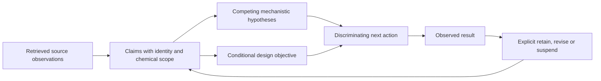

# Chemical reasoning development and evaluation

Status: evaluation foundation. No new reasoning policy is enabled in production.

Current scope: candidate-level chemical reasoning, evidence retention, and explicit
handling of previously completed versus unresolved work. A separate family-level
decision system and presentation demonstrations are deferred. Shared mechanism
knowledge remains contextual evidence, not an inherited candidate verdict.

The objective is reliable chemical decisions under incomplete evidence. Longer
explanations, valid JSON, successful retrieval and candidate counts are insufficient
measures. The live campaign has exposed evidence lost between decisions, repeated
candidate work, and evidence labels broader than the underlying observations.
Those observations are development cases and cannot establish generalization.

## Capability model

| Capability | Observable behavior | Evaluation |
|---|---|---|
| Reaction representation | Track participants, molecular occurrences, direction, reacting atoms and bond changes | Atom-mapped counterfactuals, reversals and intramolecular/intermolecular pairs |
| Mechanistic plausibility | Identify the step requiring activation and distinguish competing mechanisms | Multiple admissible hypotheses; source and chemistry checks; expert review |
| Evidence entailment | Bound claims by protein identity, substrate, assay conditions and controls | Exact-protein/homolog swaps; partial versus complete target evidence |
| Transfer to new substrates | Identify the least-supported required participant and separate recognition from catalytic capability | Partner swaps and missing-recognition-feature cases |
| Memory and revision | Retain established facts, revise contradicted claims and explain revisits | Sequential evidence updates; reordering/noise; unchanged-evidence repeats |
| Experiment selection | Choose an action that distinguishes explanations at reasonable cost | Prospective predictions and executed-action checks; cost matched alternatives |
| Design reasoning | Tie a proposed intervention to a supported limitation and specify what must be preserved | Contrasting design hypotheses and failure tests; no activity inferred from a pose |

## Proposed information flow

Every claim needs a subject, transformation/participant scope, source reference,
evidence level, unresolved limitations, and version. Hypotheses link to claims;
they do not silently replace them. An outcome is evidence only within the scope
of its measurement. Failed retrieval is not a negative biochemical observation.
Structural compatibility is distinct from measured turnover. A fact about one
partner does not establish the complete requested reaction.

The model proposes hypotheses and next actions. Deterministic checks enforce
identifiers, provenance, molecular bookkeeping and execution permissions. These
checks must not encode preferred families or candidate answers. Source entailment
and mechanism transfer require separate assessment; schema compliance is not enough.

## Work sequence and release gates

1. **Measure the baseline.** Preserve live trace examples and create independently
   specified synthetic cases. Separate model-visible observations from answer
   keys. Report malformed, missing, unavailable and scientifically failed outputs
   separately. Do not omit difficult cases from aggregate scores.
2. **Test evidence-to-decision consistency first.** Change one observation or one
   chemical constraint at a time. Include positive, negative and unresolved cases
   so indiscriminate abstention cannot pass. Check reference identity and scoped
   conclusions; have a human review whether explanations actually entail them.
3. **Test memory before adding memory.** Compare the current context with a compact
   claim ledger using the same evidence and serving model. Test both retaining
   unchanged facts and revising obsolete ones. Preserve source fingerprints,
   exact target identity, candidate identity and model/version provenance.
4. **Test executed behavior.** Feed decisions through the existing execution,
   admission, checkpoint and handoff paths. Include source outages, empty results,
   conflicting annotations and repeated actions. Check actual state transitions.
5. **Measure discovery benefit.** Run multiple budget-matched baseline/ablation
   trials on independently curated reactions. Freeze scoring before inspecting
   outputs. Measure judged candidate recovery/precision, unsupported promotions,
   mechanism coverage, repeated work, and tokens per supported hypothesis. Keep
   unjudged candidates separate; do not assume they are false positives.
6. **Extend to design.** Only after the preceding gates, use supported limitations
   to propose interventions and controls. Evaluate preservation of known function,
   discrimination between competing hypotheses and prospective experimental
   outcomes. Predicted structure quality alone cannot establish design success.

There is no universal numerical noninferiority threshold specified yet. Define
practically meaningful margins and the required number of independent cases before
the discovery-level experiment. A few agreeing examples or a single improved run
cannot supply that threshold retrospectively. Do not train or tune on a purported
held-out set; cases used to inform a fix become development cases.

## First executable evaluation

`chemical_reasoning.py` tests scoped claim verdicts and next-action choices using
synthetic evidence. It includes paired changes and negative controls. It is a
component test of evidence-to-decision consistency, not autonomous discovery,
full mechanistic reasoning, or a substitute for expert scientific adjudication.

The existing counterfactual, reactive-end, adaptive-action and independently
adjudicated evaluation modules cover complementary pieces. Keep their scopes
explicit rather than combining them into a misleading universal reasoning score.

A future production claim ledger must be opt-in until it passes these comparisons.
It must never silently seed a fresh discovery run with historical answers.

## Initial baseline and first implementation finding

The first baseline used eleven cases. Review exposed defects in the evaluation:
two assay descriptions omitted their outcomes, and the action rubric penalized
defensible alternatives without specifying costs or the decision objective. Its
original requests, responses and report are retained under
`analysis/chemical_reasoning/20261106_initial_baseline`.

Version 2 explicitly supplies those assay outcomes and reports reference-action
agreement as diagnostic, separate from claim-verdict correctness. It passed 11/11
in one serving-model baseline (22,337 accounted tokens). This does not show model
improvement over version 1, because the test changed. It establishes only that the
model can handle these small, explicit evidence packets. More challenging memory,
chemical transformation and action-selection tasks remain necessary.

An independent implementation defect was reproduced from the live campaign:
batched candidate-evidence reads return nested objects, but the decision-context
projection handled nested lists only. Five retrieved candidate records became
five empty previews. The fix preserves their reaction, function, substrate and
warning fields, source tool and status. An offline replay recovered all five;
synthetic tests cover single and batched responses through the actual next-context
builder. This is an evidence-delivery fix, not a new chemical assertion or a changed
ranking rule. The completed campaign used its originally loaded code and was not
restarted to load this fix.

A second retention gap affected prior-work bookkeeping. Partially executed batches
did not list the other requested records, and the next-context projection omitted
`existing_assessments` and `new_evidence`. The fix returns the recorded states of
unattempted requested candidates and preserves them through model-context assembly.
Native-evidence status is explicitly distinguished from target activity. A copied
saved-result replay restored three prior records previously absent from context.
Tests cover skipped, mixed and batch-limited work; no claim of reduced live model
repetition follows from these data-retention tests alone.

## Complete candidate evidence and explicit previews

The next implementation pass separates complete scientific records from historical
display summaries. New evaluations store every native reaction. A shared record
builder recovers a legacy three-reaction prefix only when it exactly matches the
complete evaluation snapshot; current non-prefix corrections and explicit empty
values remain authoritative. Target review, candidate reads and controller source
hashes use this same projection. Historical assessments whose scientific record
changes remain recorded but must be reviewed again.

Candidate reads and reasoning-memory recall now expose a target-assessment receipt:
the prior decision, partner roles, constraints, unresolved questions, reopening
condition, target/evidence fingerprints, artifact verification and current/stale
status. These receipts remain agent interpretations. Candidate inspection avoids
resending embedded copies of the previous assessment and evaluation while keeping
the complete record in an inspectable, checksummed artifact.

Batched source passages, paginated memory and failed retrievals retain their own
status and data in decision context. Scientific lists are preserved when the
context allowance permits; constrained previews report omitted fields/items and
provide complete source paths. Molecular strings and identifiers are never sliced.
Sequential tests cover correction after new controls, historical-judgment recall,
late native reactions, reordered contradictory observations and retrieval of facts
omitted under context pressure. These verify evidence delivery and state changes,
not general chemical judgment quality.

Review usage now travels with the actual model response and is saved on both the
batch and its candidate assessments. Trace totals join exact request IDs and count
a shared review request once. No association is guessed for historical batches
that lack those identifiers.

The bounded representation comparison in
`analysis/chemical_reasoning/20261106_evidence_factoring_review` completed one pair
with five candidates (67,774 tokens total); a second pair was budget-deferred.
All five decision/evidence-level labels agreed. Factoring used 5.6% fewer tokens,
but partner evidence labels and constraint classifications differed. Order/cache
effects and stochastic variation were not controlled by replication. Factoring
therefore remains optional and disabled; these data establish neither scientific
noninferiority nor full-campaign savings.

## Reading for uncertainty resolution and fact validation

Paper selection now asks what reading could establish, validate or challenge for a
candidate or catalytic route. Its inputs include current identity gaps, existing
claims, partner roles and uncertainties. Selected sources carry a question, subject,
purpose and expected effect; fact validation is a useful outcome even when the
candidate decision does not change. Sparse initial campaigns may select sources
for a concrete route-discovery question.

The previous selector appended every unselected paper back to its output, and an
explicit empty selection invoked the fallback. It therefore ordered reading but
could not defer it. Model selections now control the eligible reading set. Deferred
sources remain retrievable and reopen when their source metadata or campaign needs
change; papers outside the bounded selection window are not silently deferred.
Provider/schema failures retain the bounded fallback and cannot establish that a
paper lacks value. Legacy index-only responses are labeled as lacking objectives.

Reading objectives pass through acquisition to extraction. Passage-scoped answers,
exact quotes, text fingerprints and reading objectives are saved and surfaced to
the controller even when no new enzyme names are extracted. An absent or invented
quote leaves the reported answer unresolved. Quote presence alone does not verify
scientific entailment. Tests exercise selection, deferral, reconsideration and
saved fact-check outcomes; general reading quality and token savings still require
prospective measurement. Existing campaign processes keep their loaded code.
